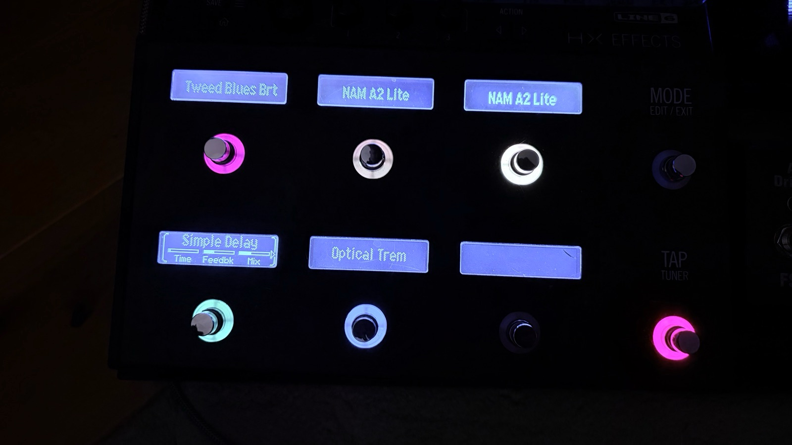

# HX Effects: NAM, Amps and Effects



This repo adds amp modelling capability to the Line 6 HX Effects in two ways: 

**Neural Amp Modeler (NAM) A2 Lite** captures can be loaded as IR files into the unit's, into the NAM A2 Lite block in Distortion>Mono

**Line 6's own 111 HX Stomp amps and 112 preamps now run on the device**- these were already in the firmware, but never listed. There is a new Amps group under the Distortion category and a Preamps group under EQ.

The repo includes tools to flash new firmware to the unit independent of Line 6 tools, and to convert NAM files so they can be loaded into the IR storage on the unit.

If you want them, it can also adds some frankly pretty daft noisy effects for those who like to make sounds that bear no resemblance to guitars- glitchy, stuttering, pure boggin' sounds only a twisted person like me could appreciate. The 'Doom Chug' is a drone maker that sounds like a downtuned set of bagpipes being tortured, especially if you pass it through the Geiger, Corrupt, Commander or Ottobit effects. Pure hummin'! 

**NO FIRMWARE IS HOSTED HERE**. You modify/build the firmware yourself, on your own computer, from Line 6's stock 3.80.0 file.

> ## ⚠️ Works on HX Effects firmware 3.80.0 only
>
> The build works on one exact file: **`HX_Effects_v3.80.0_0xd97239907.hxf`**, MD5
> **`7c2ebdf1bffb6bcc5f89dda97f91e40c`**, and refuses any other. Do **not** edit that check to force another
> firmware through: the wrong addresses can leave the unit unable to boot.

**You do this at your own risk.** Don't attempt it unless you're comfortable with command-line tools and with
recovering the unit yourself ([Recovery](#recovery)).

> **Unofficial and experimental.** Not affiliated with, endorsed by or supported by Line 6 or Yamaha Guitar Group.
> Installing modified firmware is at your own risk and may void your warranty.

## The three builds

| Build | What's in it | Command | File |
|---|---|---|---|
| **NAM** | NAM A2 Lite, Click (metronome)| `python3 build.py nam` | `build/HX_Effects_v3.80.0_NAM.hxf` |
| **NAM + Amps** | the above + the HX Stomp's 111 amps and 112 preamps | `python3 build.py amps` | `build/HX_Effects_v3.80.0_NAM_Amps.hxf` |
| **NAM + Amps + Effects** | the above + Geiger, Commander, Corrupt, Ottobit, Doom Chug | `python3 build.py full` | `build/HX_Effects_v3.80.0_NAM_Amps_Effects.hxf` |

Each command builds the image, checks it, and prints its MD5 and the flash command. Flash only an image that
ends `verified ALL OK`; see [Quick install](#quick-install) for the steps.

## What's in the images

**NAM A2 Lite** — Distortion → Mono (in place of the mono Regal Bass DI). Up to three per preset (two in the
full build).

| Knob | |
|---|---|
| Model | The User IR slot holding the capture, 1–21 |
| Input | −20 to +20 dB (0 dB at 5.0) |
| Bass / Mid / Treble / Presence | ±12 dB (flat at 5.0) |
| Ch Vol | Output level (0 dB at 5.0) |
| Polarity | Normal / Inverted |

**Amps** — Distortion → Amps: every amp the HX Stomp has (94 guitar, 17 bass), with the Stomp's knobs.
**Preamps** — EQ → Preamps: every preamp the HX Stomp has (94 guitar, 17 bass, 1 mic); as on the Stomp, each has
its amp's name. Up to three amps and preamps per preset. No stock block is replaced. These images also carry a small USB diagnostic interface
(`tools/memwin.py`) for reading the unit's log.

**Effects** — each takes over the stock block in brackets (any stereo version stays):

| Effect | Where | What it is |
|---|---|---|
| Click | Delay → Mono (Mod/Chorus Echo) | Metronome, synced to tap tempo (in every build) |
| Geiger | Distortion → Mono (Megaphone) | Bit crusher with 16 shaping curves |
| Commander | Distortion → Mono (Xenomorph Fuzz) | Square-wave octave fuzz |
| Corrupt | Distortion → Legacy (Octave Fuzz) | Tracking square-wave synth |
| Ottobit | Distortion → Mono (Bitcrusher) | Sequenced bit crusher with stutters |
| Doom Chug | Distortion → Mono (Pocket Fuzz) | Low drone generator |

## Quick install

Needs macOS or Linux (on Windows, build under WSL and flash with Line 6 Updater), Python 3.10+ (check with
`python3 --version`), and `make` with a C compiler (`xcode-select --install` on a Mac, `build-essential` on Linux).

1. **Get the repo.** Run every command below from this folder.
   ```
   git clone https://github.com/scottlynn73/hx-effects-nam-lite.git && cd hx-effects-nam-lite
   ```
2. **Get the stock firmware.** At <https://line6.com/software/> pick *HX Effects* → *Firmware* and download
   **3.80.0**. Check that `md5 -q <file>` (macOS) or `md5sum <file>` (Linux) prints
   `7c2ebdf1bffb6bcc5f89dda97f91e40c`, and put it in `firmware/` keeping its name,
   `HX_Effects_v3.80.0_0xd97239907.hxf`. Download **Line 6 Updater** from the same page.
3. **Set up Python** once:
   ```
   python3 -m venv .venv && source .venv/bin/activate
   pip install numpy unicorn==2.1.4 capstone==5.0.9 pyusb libusb-package
   ```
   In every new terminal, run `source .venv/bin/activate` first.
4. **Build** one of the three images, e.g. `python build.py full`. It prints each step (long pauses are normal):
   a few minutes, the full one about ten. If it ends `FAILED verification: do not flash it`, don't flash.
5. **Back up** your presets and IRs in HX Edit, then close HX Edit.
6. **Flash** with Line 6 Updater (**Choose File** → your image; if it reports a problem, run it again), or:
   ```
   python tools/flash.py flash build/<your image>.hxf
   ```
   It asks you to type `flash`, writes the firmware and waits for the unit to boot (about two minutes).
7. **Load captures.** Convert each 3-channel A2 Lite `.nam` capture:
   ```
   python tools/nam2ir.py "My Amp.nam" -o "My Amp.wav" --match
   ```
   In HX Edit's Impulses tab (first switch to a preset with no NAM block in it), import the `.wav` into a User IR
   slot **1–21**, then set the NAM block's Model knob to that slot. `--match` levels captures to the same
   loudness. Demo captures, already converted, are in `captures/`.

## Limits

- HX Edit can't edit NAM, the amps or the effects ("code −8200"); edit them on the unit. IR import works.
- NAM's Model knob reaches User IR slots 1–21. Presets store the slot number, not the capture.
- Only 3-channel A2 Lite captures fit.
- Amps and preamps: three per preset at most, together; no cabs (put an IR block after the amp).
- With one NAM in each path of a split, the bottom path is quieter.
- Doom Chug's Chug knob does little except lower the level.

## Recovery

If the unit shows **"Boot Failure"**, stays on the splash screen or boots dark, put it back on stock. The build
never touches the bootloader, and your presets, IRs and settings survive.

1. Close HX Edit and anything else using the unit over USB. Power the unit off, USB still connected.
2. Hold the **right arrow (>)** button and power on; keep holding about three seconds.
3. Open Line 6 Updater, select the HX Effects, **Choose File**, and pick the stock
   `firmware/HX_Effects_v3.80.0_0xd97239907.hxf`. Let it finish, then power-cycle.

If Updater doesn't see the unit, try another USB port or cable (no hub) and hold **>** longer. A failed flash can
simply be retried. Line 6's own guide: [reset procedures](https://kb.line6.com/helix-rack-lt-fx-stomp-reset-procedures-and-troubleshooting-tricks).

## Copyright notice

**No Line 6 / Yamaha Guitar Group code, data or firmware is in this repository, and none is
distributed with it.** Specifically:

- The repository contains only original work: Python tools, a SHARC assembler and simulator, a NAM
  kernel written from scratch in SHARC assembly, and documentation. It is released under the GPL‑3.0,
  as the upstream project is.
- The stock HX Effects firmware is **not** included. Each user obtains their own copy directly from
  Line 6's download site under Line 6's terms, puts it in a folder this repository ignores
  (`firmware/`), and the build reads it on the user's own computer. The `.gitignore` excludes the
  firmware, the build output and every `.hxf` and `.l6ia` file so that none can be committed.
- The build output is Line 6's firmware with modifications. It is a derivative of their copyrighted
  work and **must not be redistributed**: don't upload the built `.hxf`, share it, or post it in
  forums. Each person builds their own from their own copy of the stock firmware.
- "Line 6", "Helix", "HX Effects", "HX Edit" and "Line 6 Updater" are trademarks of Line 6, Inc. /
  Yamaha Guitar Group, Inc., used here only to identify the product the tools work with. "Neural Amp
  Modeler" and "NAM" refer to Steven Atkinson's open‑source project. This project is not affiliated
  with, endorsed by or supported by any of them.
- The tools exist to let an owner run software of their choosing on hardware they own, for personal,
  non‑commercial use. No copy protection, signing or encryption is bypassed: the firmware container
  uses checksums only, which the tools recompute. The offsets and formats documented here were
  determined by inspecting the publicly downloadable firmware file.
- Modifying your unit's firmware may void its warranty and is entirely at your own risk; the authors
  accept no liability for any damage to hardware or data.

If you represent Line 6 or Yamaha Guitar Group and believe any part of this repository infringes
your rights, open an issue or contact the maintainer and it will be addressed promptly.

*This notice describes what the repository contains and how it is meant to be used; it is not legal
advice, and the maintainer is not a lawyer.*

## Thanks

This project exists because of **[nocaseguy](https://github.com/nocaseguy)** and
**[hx-stomp-nam-lite](https://github.com/nocaseguy/hx-stomp-nam-lite)**. Everything hard here is
theirs: the NAM A2 Lite kernel written from scratch in SHARC assembly, the SHARC assembler and
cycle‑accurate simulator with the bit‑exact reference check, the `.hxf`/L6IA container tools, the
idea of smuggling a capture's weights through a User IR slot, and the whole reverse‑engineering of
how the Helix firmware builds a block from its model table, graph library and DSP boot stream. The
HX Effects port is a few hundred lines of offsets and workarounds on top of that foundation; without
it there would have been nothing to port. Thank you.

## Licence

GPL‑3.0‑or‑later, as the upstream project, for the tools and documentation. No Line 6 code or data is
included. The demo captures in `captures/` are my own and may be used freely.
