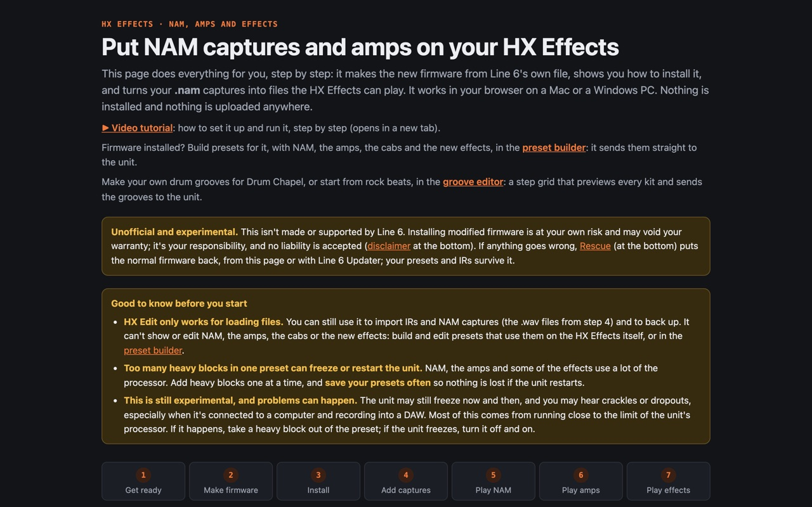
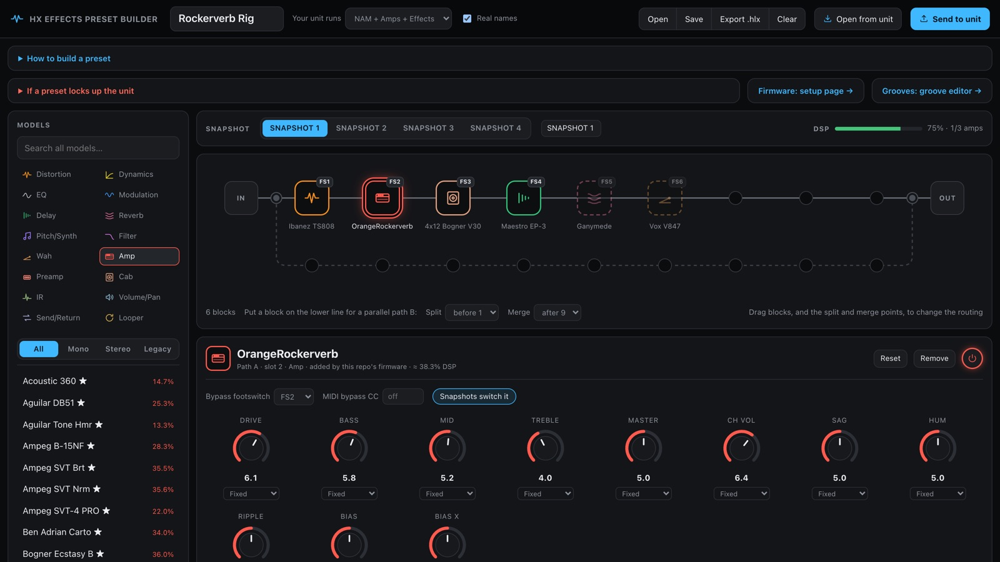
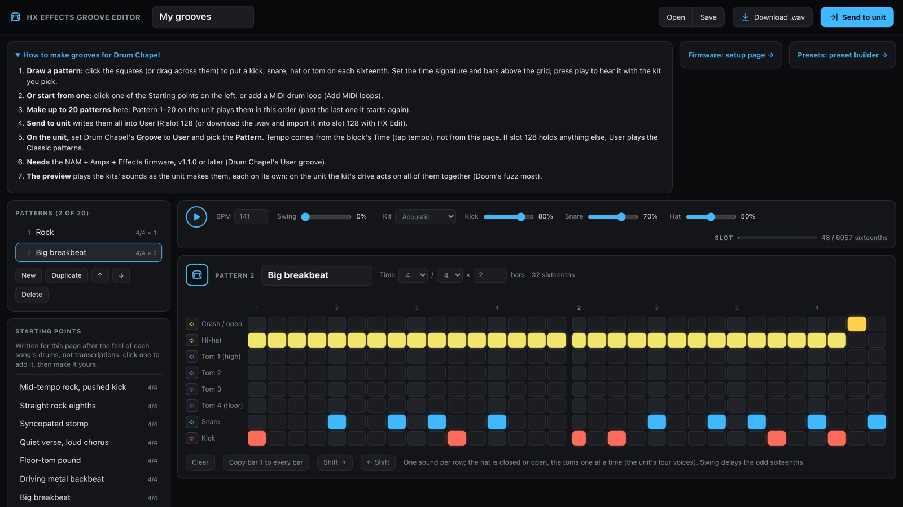

# HX Effects: NAM, Amps and Effects


This repo adds amp and cab modelling to the Line 6 HX Effects:

- **Neural Amp Modeler (NAM) A2 Lite**: captures are loaded into the unit's IR slots and played by the NAM A2 Lite
  block (Distortion → Mono).
- **Line 6's own 111 HX Stomp amps and 112 preamps** now run on the device. They were already in the firmware but
  never listed: there's a new Amps group under Distortion and a Preamps group under EQ.
- **Line 6's own 41 HX Stomp legacy cabs**, also already in the firmware, in a new Cabs group under EQ, with Mic,
  Distance and the rest: up to two per preset, so a cab after NAM or an amp in each path (NAM + Amps + Effects
  build).

If you want them, it also adds some frankly pretty daft noisy effects for those who like to make sounds that bear no
resemblance to guitars: glitchy, stuttering, pure boggin' sounds only a twisted person like me could appreciate. The
'Doom Chug' is a drone maker that sounds like a downtuned set of bagpipes being tortured, especially if you pass it
through the Bolt, Rocket!, Quality Polis, Garrrry Tank or Bam Crusher effects. Pure hummin'!

**No firmware is hosted here.** You build it yourself, on your own computer, from Line 6's stock 3.80.0 file.

## Get started

Three pages do everything in your browser (Chrome or Edge, Mac or Windows). Nothing is installed and nothing is
uploaded.

**[▶ Video tutorial](https://www.youtube.com/watch?v=yktLS1vPSZ4)**: how to set it up and run it, step by step.

<table>
<tr>
<td width="33%" valign="top">
<a href="https://scottlynn73.github.io/hx-effects-nam-lite/"></a><br>
<b><a href="https://scottlynn73.github.io/hx-effects-nam-lite/">Setup page</a></b>: makes the firmware from Line 6's
file, installs it over USB, and converts and sends your NAM captures.
</td>
<td width="33%" valign="top">
<a href="https://scottlynn73.github.io/hx-effects-nam-lite/preset-builder/"></a><br>
<b><a href="https://scottlynn73.github.io/hx-effects-nam-lite/preset-builder/">Preset builder</a></b>: builds presets
with NAM, the amps, the cabs and the effects (HX Edit can't) and sends them to the unit.
</td>
<td width="33%" valign="top">
<a href="https://scottlynn73.github.io/hx-effects-nam-lite/groove-editor/"></a><br>
<b><a href="https://scottlynn73.github.io/hx-effects-nam-lite/groove-editor/">Groove editor</a></b>: designs up to 20
drum patterns for Drum Chapel in any time signature, sixteenth by sixteenth, previews them with the unit's kits, takes
MIDI loops, and sends them to the unit (the Groove knob's User setting).
</td>
</tr>
</table>

Prefer a terminal? The same firmware can be built and flashed from this repo: see [Manual install](#manual-install).

> [!WARNING]
> **Unofficial and experimental, at your own risk.** Not made, endorsed or supported by Line 6 or Yamaha Guitar
> Group; modified firmware may void your warranty.
> - Works on **HX Effects 3.80.0 only**: the build checks for the exact file
>   `HX_Effects_v3.80.0_0xd97239907.hxf` (MD5 `7c2ebdf1bffb6bcc5f89dda97f91e40c`) and refuses any other. Don't
>   edit that check: the wrong addresses can leave the unit unable to boot.
> - Know how to put the unit back on stock firmware before you start: [Recovery](#recovery).
> - Using any of this is **your responsibility**, and no liability is accepted: read the [Disclaimer](#disclaimer).

## The three builds

| Build | What's in it |
|---|---|
| **NAM** | NAM A2 Lite, Click (metronome) |
| **NAM + Amps** | the above + the HX Stomp's 111 amps and 112 preamps |
| **NAM + Amps + Effects** | the above + the HX Stomp's 41 legacy cabs (EQ → Cabs) + Bolt, Rocket!, Garrrry Tank, Quality Polis, Bam Crusher, Doom Chug, Drum Chapel (a drum machine) and more |

**NAM A2 Lite** (Distortion → Mono, in place of the mono Regal Bass DI): up to three per preset (two in NAM + Amps +
Effects). Model picks the User IR slot holding the capture (1–21); Input ±20 dB; Bass, Mid, Treble and Presence
±12 dB; Ch Vol; Polarity. Knobs centre at 5.0. With Input at 5.0, a capture that records its interface's level
(`input_level_dbu`) gets your guitar at the level the captured amp got, if the HX Effects reaches 0 dBFS at
+11.5 dBu. That figure is the HX Stomp's, measured by users, and has not been measured on an HX Effects; it assumes
Global Settings → Input Level on Instrument. If a capture feels too clean or too hot, use the Input knob.

**Amps** (Distortion → Amps) and **Preamps** (EQ → Preamps): every amp and preamp the HX Stomp has, with its knobs;
up to three per preset, together. No stock block is replaced.

**Cabs** (EQ → Cabs, NAM + Amps + Effects): the HX Stomp's 41 legacy cabs, each with Mic, Distance, Low Cut, High
Cut, Early Reflections and Level; up to two cab blocks per preset (say one in each path). No dual cabs: the HX
Effects has no screen to choose a dual's second cab. The new-style cabs and the Amp+Cab blocks are not included:
their sound data isn't in this firmware. In NAM + Amps, put an IR block after the amp, with a cab IR in a User IR
slot. (From a terminal, `build.py amps` adds the cabs too, but that image hasn't been tested on a unit: use
`--cabs none` to leave them out.) The amp builds also carry a small USB diagnostic interface (`tools/memwin.py`) for
reading the unit's log.

**Effects**: each takes over the stock block in brackets (any stereo version stays).

| Effect | Where | What it is |
|---|---|---|
| Click | Delay → Mono (Mod/Chorus Echo) | Metronome, synced to tap tempo (in every build) |
| Bolt, Rocket! | Distortion → Mono (Megaphone) | Bit crusher with 16 shaping curves |
| Garrrry Tank | Distortion → Mono (Xenomorph Fuzz) | Square-wave octave fuzz |
| Quality Polis | Distortion → Legacy (Octave Fuzz) | Tracking square-wave synth |
| Bam Crusher | Distortion → Mono (Bitcrusher) | Sequenced bit crusher with stutters |
| Doom Chug | Distortion → Mono (Pocket Fuzz) | Low drone generator |

## Limits

- HX Edit can't edit NAM, the amps, the cabs or the effects ("code −8200"): use the unit or the preset builder. IR
  import works.
- NAM's Model knob reaches User IR slots 1–21. Presets store the slot number, not the capture.
- Only 3-channel A2 Lite captures fit.
- Amps and preamps: three per preset at most, together.
- Cabs: two cab blocks per preset (NAM + Amps + Effects only); no dual cabs.
- With one NAM in each path of a split, the bottom path is quieter.
- Doom Chug's Chug knob does little except lower the level.

## Recovery

**The unit won't start** ("Boot Failure", stuck on the splash screen, or dark): put it back on stock. The build never
touches the bootloader, and your presets, IRs and settings survive.

1. Close HX Edit and anything else using the unit over USB. Power the unit off, USB still connected.
2. Hold the **right arrow (>)** button and power on; keep holding about three seconds.
3. Use the **Rescue** section at the bottom of the [setup page](https://scottlynn73.github.io/hx-effects-nam-lite/),
   or Line 6 Updater: select the HX Effects, **Choose File**, pick the stock `HX_Effects_v3.80.0_0xd97239907.hxf`,
   let it finish, then power-cycle.

If Updater doesn't see the unit, try another USB port or cable (no hub) and hold **>** longer. A failed flash can
simply be retried. Line 6's own guide: [reset procedures](https://kb.line6.com/helix-rack-lt-fx-stomp-reset-procedures-and-troubleshooting-tricks).

**A preset locks the unit up**: switch it off and on; if it locks again while starting, hold **FS4 + FS5** as you
switch it on (it starts on 1A, Global Settings reset, presets kept). The preset builder's *If a preset locks up the
unit* has the full steps.

## Manual install

For people happy with a terminal: macOS or Linux (on Windows, build under WSL and flash with Line 6 Updater),
Python 3.10+ and `make` with a C compiler (`xcode-select --install` on a Mac, `build-essential` on Linux).

1. **Get the repo**, and run every command below from its folder:
   ```
   git clone https://github.com/scottlynn73/hx-effects-nam-lite.git && cd hx-effects-nam-lite
   ```
2. **Get the stock firmware**: at <https://line6.com/software/> pick *HX Effects* → *Firmware* → **3.80.0**. Check
   `md5 -q <file>` (macOS) or `md5sum <file>` (Linux) prints `7c2ebdf1bffb6bcc5f89dda97f91e40c`, and put it in
   `firmware/` keeping its name. Get **Line 6 Updater** from the same page.
3. **Set up Python** once (then `source .venv/bin/activate` in every new terminal):
   ```
   python3 -m venv .venv && source .venv/bin/activate
   pip install numpy unicorn==2.1.4 capstone==5.0.9 pyusb libusb-package
   ```
4. **Build**: `python build.py nam`, `amps` or `full` (NAM + Amps + Effects), into `build/`. It takes a few
   minutes (the full one about ten) and prints the MD5 and the flash command. Flash only an image that ends
   `verified ALL OK`.
5. **Back up** your presets and IRs in HX Edit, then close HX Edit.
6. **Flash** with Line 6 Updater (**Choose File** → your image), or `python tools/flash.py flash build/<image>.hxf`
   (type `flash` to confirm; it waits for the unit to boot, about two minutes).
7. **Load captures**: `python tools/nam2ir.py "My Amp.nam" -o "My Amp.wav" --match` (`--match` levels captures to
   the same loudness), then import the `.wav` into a User IR slot 1–21 in HX Edit's Impulses tab (switch to a preset
   with no NAM block first), or send it with `python tools/ir_upload.py put 5 "My Amp.wav"` (`list`, `rename`,
   `copy`, `delete` and `get` do the rest). Demo captures, already converted, are in `captures/`.

## Disclaimer

**Everything here is provided "as is", without warranty of any kind**, express or implied, including any warranty
that it works, is fit for a particular purpose, or won't damage your equipment or data.

**Using it is entirely your own decision and your own responsibility.** That covers building or installing modified
firmware, using the setup page or the preset builder, sending presets or IRs to your unit, and anything else in this
repository. You are responsible for checking what you install and for backing up your presets, IRs and settings
first.

**To the fullest extent permitted by law, the author and contributors accept no liability** for any loss or damage of
any kind arising from using, or being unable to use, this repository, the web pages or anything built with them.
That includes damage to your HX Effects or any other equipment, a unit that won't start, lost or corrupted presets,
IRs or settings, hearing damage or harm from unexpected or loud sounds, a voided warranty, and any direct, indirect,
incidental or consequential loss. If you don't accept this, don't use it.

Nothing here is affiliated with, endorsed by or supported by Line 6 or Yamaha Guitar Group; don't ask them for help
with a modified unit. The GPL‑3.0 licence's own "no warranty" and "limitation of liability" terms (sections 15 and 16)
also apply.

## Copyright notice

**No Line 6 / Yamaha Guitar Group code or firmware is in this repository, and none is distributed with it.**

- The repository contains original work: Python tools, a SHARC assembler and simulator, a NAM kernel written from
  scratch in SHARC assembly, the two web pages, and documentation, released under the GPL‑3.0 as the upstream
  project is.
- The one piece of Line 6 data is factual and extracted, not copied: the preset builder's model list
  (`tools/preset-builder/fw-catalog.js`, generated by `make_catalog.js`) holds each model's name, knob names and
  ranges and DSP cost, so the page can build presets the unit accepts. No Line 6 file, code or firmware bytes are
  in it.
- Drum Chapel's Acoustic kit plays five drum hits from **Naked Drums** by Wilkinson Audio, licensed
  [CC BY 4.0](https://creativecommons.org/licenses/by/4.0/) (the SFZ release,
  [sfzinstruments/WilkinsonAudio.NakedDrums](https://github.com/sfzinstruments/WilkinsonAudio.NakedDrums)): mixed
  from its mics, trimmed, resampled to 24 kHz and stored as 8‑bit mu‑law in `effects/drumchapel/samples_data.h`.
- The stock HX Effects firmware is **not** included. Each user gets their own copy from Line 6's download site
  under Line 6's terms; the build reads it on their own computer. `.gitignore` excludes the firmware, the build
  output and every `.hxf` and `.l6ia` file.
- The build output is Line 6's firmware with modifications, a derivative of their copyrighted work: **don't
  redistribute it** (no uploading, sharing or posting the built `.hxf`). Each person builds their own.
- "Line 6", "Helix", "HX Effects", "HX Edit" and "Line 6 Updater" are trademarks of Line 6, Inc. / Yamaha Guitar
  Group, Inc., used only to identify the product. "Neural Amp Modeler" and "NAM" refer to Steven Atkinson's
  open‑source project. This project is not affiliated with, endorsed by or supported by any of them.
- The tools let an owner run software of their choosing on hardware they own, for personal, non‑commercial use. No
  copy protection, signing or encryption is bypassed: the firmware container uses checksums only, which the tools
  recompute. The offsets and formats documented here come from inspecting the publicly downloadable firmware file.
- Modifying your unit's firmware may void its warranty and is entirely at your own risk: see the
  [Disclaimer](#disclaimer).

If you represent Line 6 or Yamaha Guitar Group and believe any part of this repository infringes your rights, open
an issue or contact the maintainer and it will be addressed promptly.

*This notice describes what the repository contains and how it is meant to be used; it is not legal advice, and the
maintainer is not a lawyer.*

## Thanks

This project exists because of **[nocaseguy](https://github.com/nocaseguy)** and
**[hx-stomp-nam-lite](https://github.com/nocaseguy/hx-stomp-nam-lite)**. Everything hard here is theirs: the NAM A2
Lite kernel written from scratch in SHARC assembly, the SHARC assembler and cycle‑accurate simulator with the
bit‑exact reference check, the `.hxf`/L6IA container tools, the idea of smuggling a capture's weights through a User
IR slot, and the whole reverse‑engineering of how the Helix firmware builds a block from its model table, graph
library and DSP boot stream. The HX Effects port is a few hundred lines of offsets and workarounds on top of that
foundation; without it there would have been nothing to port. Thank you.

Drum Chapel's Acoustic kit is [Naked Drums](https://github.com/sfzinstruments/WilkinsonAudio.NakedDrums) by
Wilkinson Audio (CC BY 4.0), converted to SFZ by kinwie. Thank you for making it free.

## Licence

GPL‑3.0‑or‑later, as the upstream project, for the tools, pages and documentation. No Line 6 code or firmware is
included; the preset builder's extracted model list is described in the copyright notice. The demo captures in
`captures/` are my own and may be used freely.
